<div align="center">


# MCP Workbench

**A self-hostable AI workbench.** Chat with any model, give it tools through MCP, teach it skills,
install Claude Code plugins, ground it in your own documents, and measure what it does.

[](https://nextjs.org/)
[](https://react.dev/)
[](https://heroui.com/)
[](https://ai-sdk.dev/)
[](https://modelcontextprotocol.io/)
[](https://github.com/pgvector/pgvector)
[](LICENSE)

[Features](#features) · [Screenshots](#screenshots) · [Quick start](#quick-start) · [Architecture](#architecture) · [Security](#security-model) · [Development](#development) · [Roadmap](#roadmap)

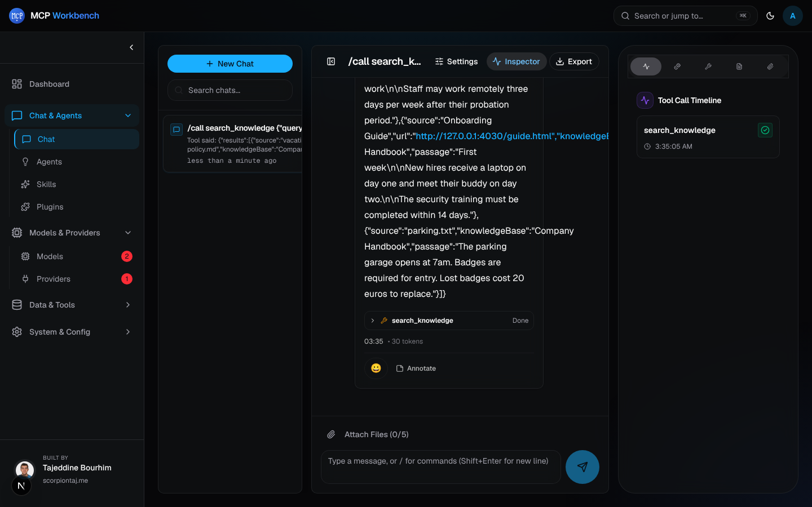

</div>

---

## Why MCP Workbench

Most chat UIs stop at "pick a model, type a prompt". MCP Workbench is the bench around the model:

| You want to… | MCP Workbench gives you |
| --- | --- |
| Use whichever model fits the job | **12 chat providers** behind one streaming chat (OpenAI, Anthropic, Google, Groq, OpenRouter, Together, Mistral, Cohere, Hugging Face, Ollama, LM Studio, any OpenAI-compatible server) |
| Let the model act, safely | **Remote MCP servers** with per-server approval policies and signed approvals |
| Reuse expertise | **Agents**, **Agent Skills** (`SKILL.md`) and **slash commands** |
| Bring the ecosystem in | **Claude Code plugins** and marketplaces installed straight from GitHub |
| Answer from your own data | **Knowledge bases** with hybrid (vector + keyword) retrieval and citations |
| Choose and justify models | **Side-by-side comparison** and **usage analytics** |
| Go beyond text | **Studio** for image generation, speech-to-text and text-to-speech |
| Automate and share | **Scheduled agents**, **shareable read-only chats** and **conversation branching** |

It is multi-user from the ground up: every record is scoped to its owner, secrets are encrypted,
and uploaded files are private.

---

## Features

<table>
<tr>
<td width="50%" valign="top">

### 💬 Chat
- Streaming on the Vercel AI SDK; stop, retry, regenerate, edit
- Per-chat model, system prompt and sampling settings
- Image, PDF and text attachments
- `/` **slash commands** with `$ARGUMENTS` and `$1…$9`
- Reactions, annotations, JSON/CSV export; history search over titles **and message text**
- **Share** a read-only link (revocable; attachments and system prompt stay private) and **branch** from any reply
- **Inspector**: every tool call with input, output and timing

### 🤖 Agents
- Instructions, default model, temperature, step budget, starter prompts
- Attach **MCP servers, skills and knowledge bases**
- Six built-ins; share yours without exposing tools, keys or documents
- **Schedules**: run an agent on a cron schedule in your time zone; each run lands in a new chat and can notify a Slack, Discord or any HTTPS webhook

### 🔌 MCP
- Remote servers over Streamable HTTP or SSE, with encrypted auth headers or **OAuth sign-in** (dynamic registration, PKCE, token refresh)
- **Local stdio servers** through the bundled [bridge](#local-stdio-mcp-servers)
- Approval policy per server: never · unless read-only · always
- **Inspector** to run tools, read resources and get prompts
- **Official MCP Registry** browser with one-click add
- **Import** `mcpServers` configs from Claude Desktop, Cursor or VS Code

</td>
<td width="50%" valign="top">

### 🧩 Skills, commands and plugins
- **Agent Skills** loaded on demand (progressive disclosure), written in-app or imported from GitHub
- **Claude Code plugins** from a repo or `.claude-plugin/marketplace.json`: review, install, update, disable or uninstall skills, agents, commands and MCP servers as one unit

### 📚 Knowledge (RAG)
- PDF, HTML, Markdown, text, code, CSV, JSON, web pages, pasted text, dataset rows
- Chunking with overlap, embeddings from any provider, stored in **pgvector**
- **Hybrid retrieval**: cosine similarity + Postgres full-text, merged with reciprocal rank fusion
- `search_knowledge` tool with cited sources; retrieval playground and chunk viewer
- **HNSW** indexes for common embedding sizes (384 to 3072 dimensions)
- Optional **reranking** (Cohere or Together) of the hybrid results

### 📊 Compare, measure, explore
- **Compare** up to four models: streaming side by side with first-token time, total time, tokens and tokens/s
- **Usage analytics**: tokens per day, by model, tool calls and agents
- **Datasets**: CSV/TSV/Parquet preview with column statistics
- **Embeddings playground** with a similarity heatmap
- **Python notebook** in the browser (Pyodide)

### 🎨 Studio
- **Images** from OpenAI, Google Imagen, Together (FLUX) or any compatible server
- **Speech to text** (Whisper, GPT-4o transcribe, Groq) and **text to speech** with voices
- Results saved privately with download and history

</td>
</tr>
</table>

---

## Screenshots

<table>
<tr>
<td width="50%">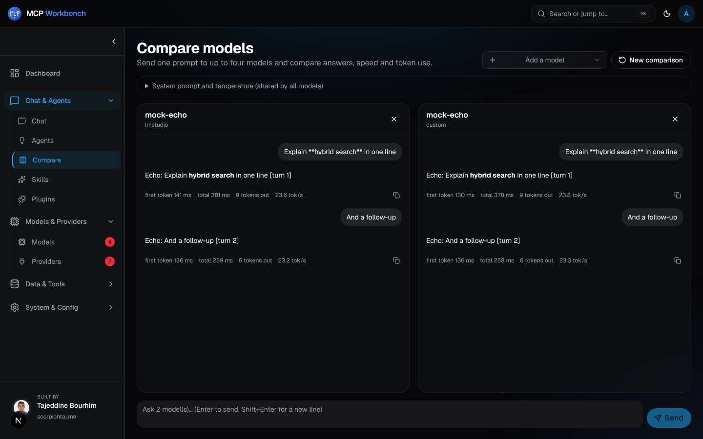<p align="center"><b>Compare models</b></p></td>
<td width="50%">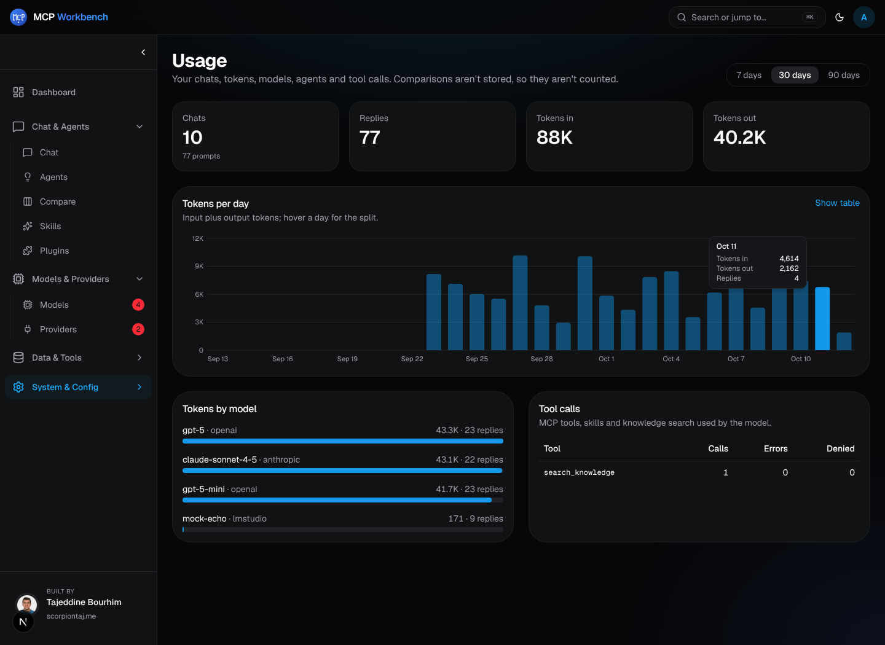<p align="center"><b>Usage analytics</b></p></td>
</tr>
<tr>
<td>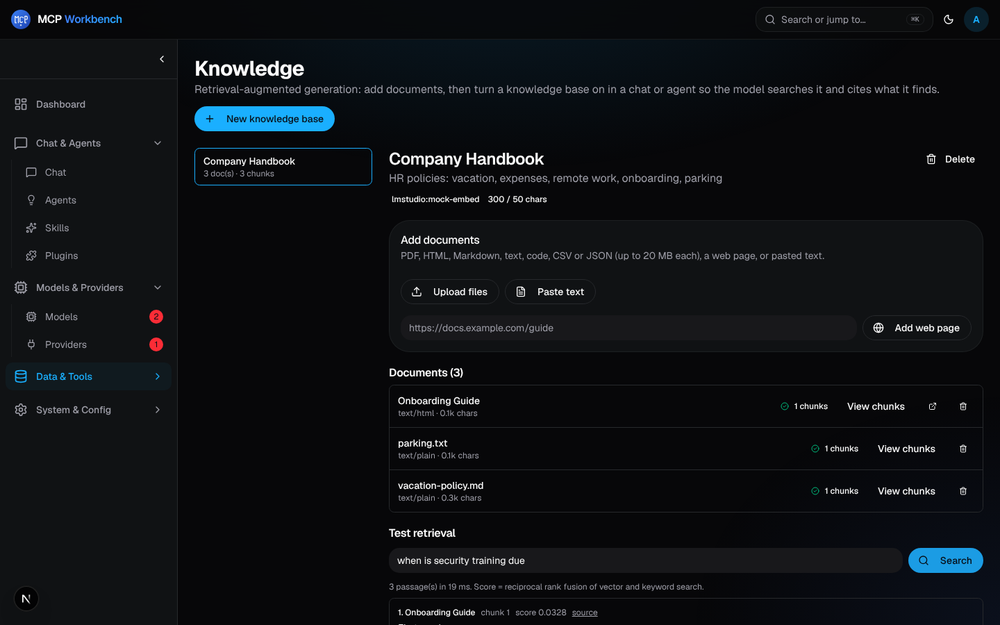<p align="center"><b>Knowledge bases and retrieval</b></p></td>
<td>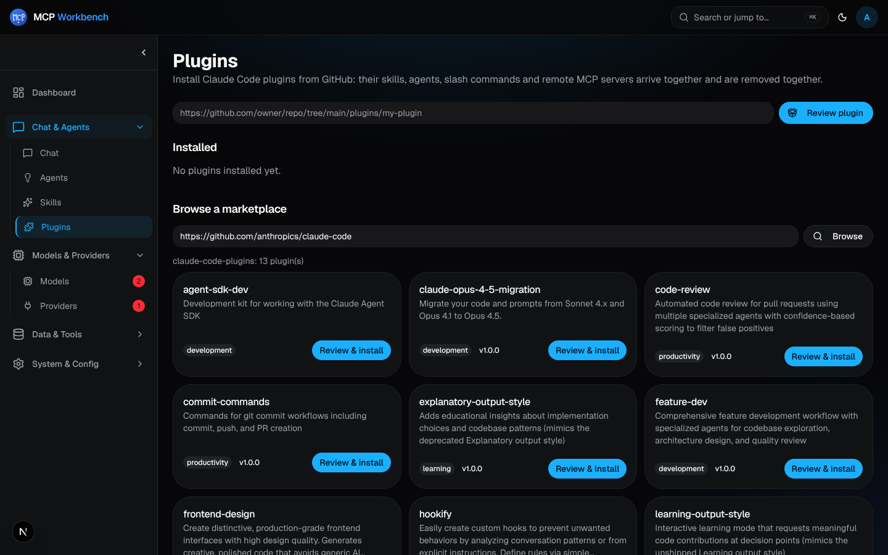<p align="center"><b>Plugins from a marketplace</b></p></td>
</tr>
<tr>
<td>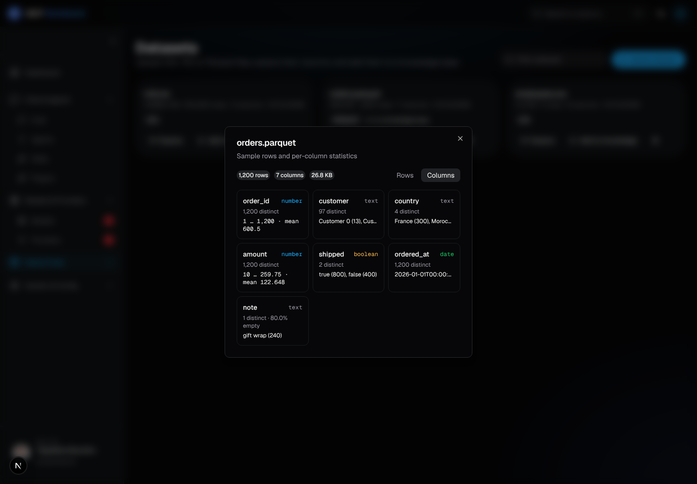<p align="center"><b>Dataset column profile</b></p></td>
<td>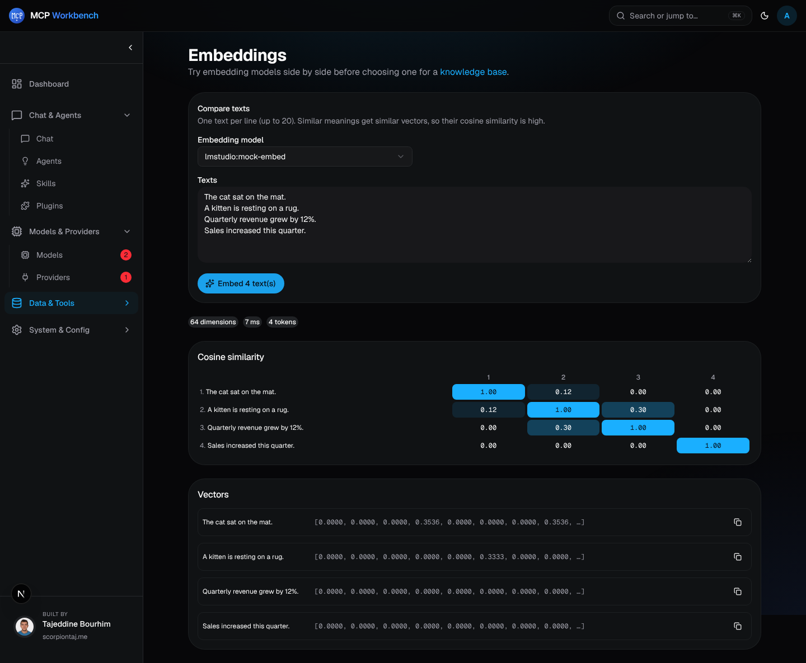<p align="center"><b>Embeddings playground</b></p></td>
</tr>
<tr>
<td>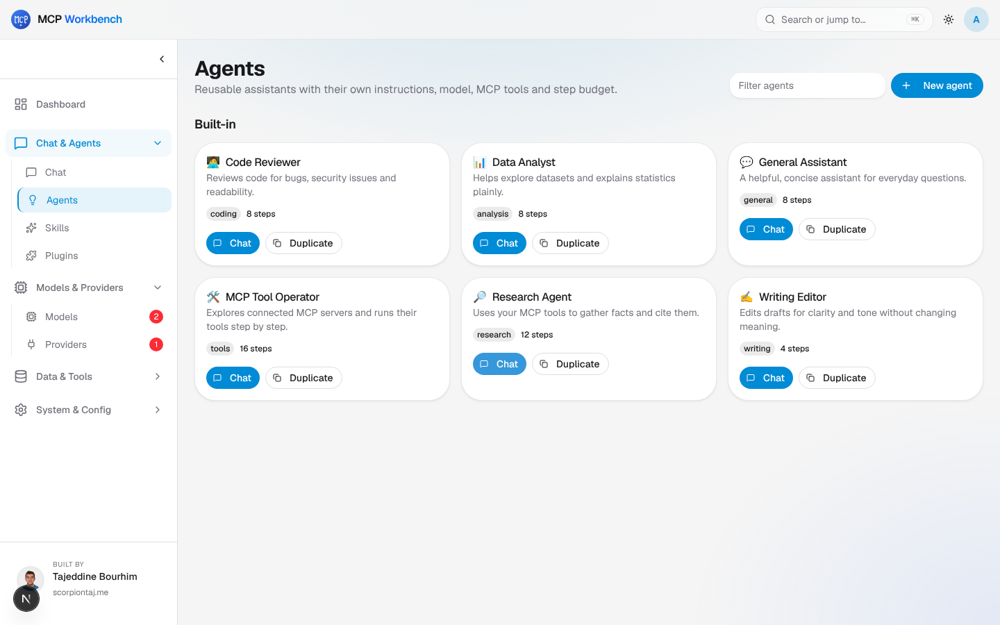<p align="center"><b>Agents (light theme)</b></p></td>
<td>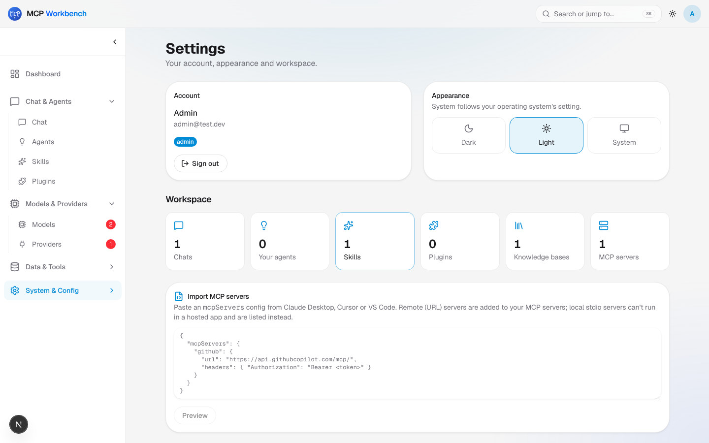<p align="center"><b>Settings and MCP config import</b></p></td>
</tr>
<tr>
<td>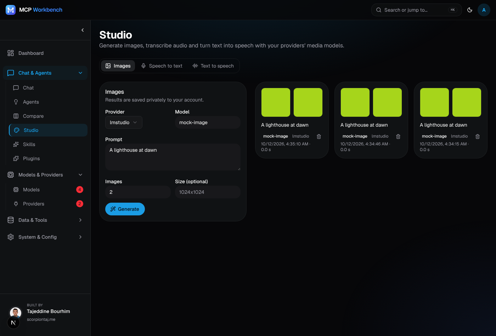<p align="center"><b>Studio: images, speech to text, text to speech</b></p></td>
<td>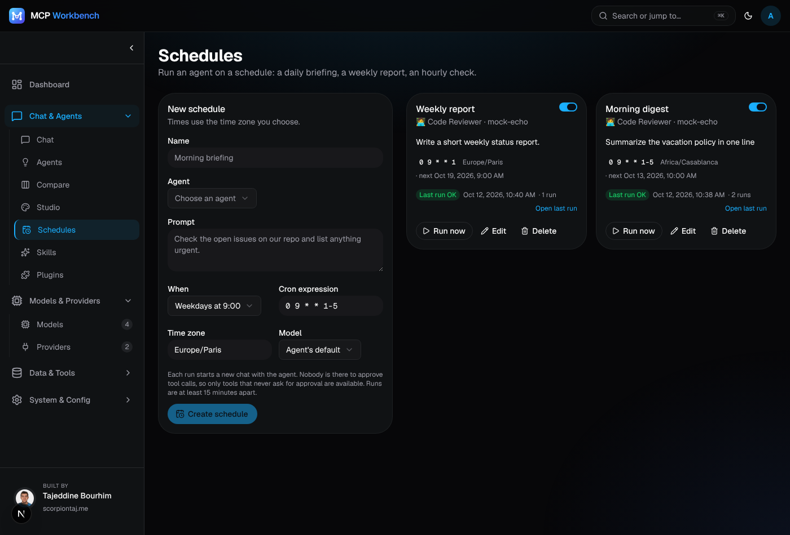<p align="center"><b>Scheduled agents</b></p></td>
</tr>
<tr>
<td colspan="2">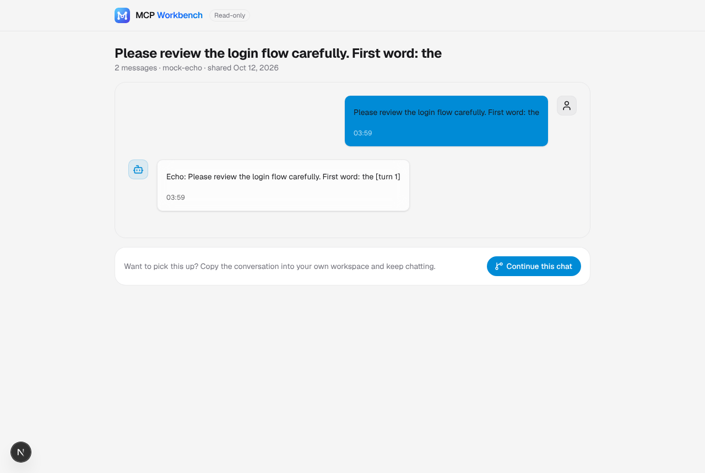<p align="center"><b>Shareable read-only chat (light theme)</b></p></td>
</tr>
</table>

---

## Quick start

**Requirements:** [Bun](https://bun.sh) and PostgreSQL with [pgvector](https://github.com/pgvector/pgvector) (the dev compose file runs it for you).

```bash
git clone https://github.com/scorpiontaj/mcp-workbench.git
cd mcp-workbench
bun install

cp .env.example .env
# Required: ENCRYPTION_KEY and BETTER_AUTH_SECRET (openssl rand -base64 32), ADMIN_EMAILS (your email)

bun run docker:dev     # PostgreSQL + pgvector on localhost:5432
bun run db:migrate     # tables, the vector extension and built-in agents
bun run dev            # http://localhost:3000
```

1. Sign up. The emails in `ADMIN_EMAILS` become admins.
2. Add a provider on **Providers**: an API key, or the URL of a local Ollama / LM Studio.
3. Start a chat, or create a knowledge base with an embedding model such as `text-embedding-3-small` or `nomic-embed-text`.

**Production:** `bun run docker:prod` builds a multi-stage image that runs as non-root; then apply migrations as described in
[docker/README.md](docker/README.md). Set `ALLOW_PRIVATE_PROVIDER_URLS=false` on a public deployment.

<details>
<summary><b>Environment variables</b></summary>

| Variable | Purpose |
| --- | --- |
| `DATABASE_URL` | PostgreSQL with pgvector |
| `ENCRYPTION_KEY` | Encrypts provider keys and MCP headers (required, 32+ chars) |
| `BETTER_AUTH_SECRET`, `BETTER_AUTH_URL` | Session signing and the app's public URL (required) |
| `ADMIN_EMAILS` | Comma-separated emails promoted to admin on sign-up |
| `GITHUB_CLIENT_ID/SECRET`, `GOOGLE_CLIENT_ID/SECRET` | Optional OAuth sign-in |
| `ALLOW_PRIVATE_PROVIDER_URLS` | Allow LAN/loopback provider URLs (default: on outside production) |
| `UPLOAD_DIR` | Where private uploads are stored (default `./storage/uploads`) |
| `GITHUB_TOKEN` | Raises GitHub rate limits for skill and plugin imports |
| `OPENAI_API_KEY`, `ANTHROPIC_API_KEY`, `GOOGLE_API_KEY` | Optional server-wide fallback keys |
| `REDIS_URL` | Optional cache |
| `SCHEDULER` | `off` stops this instance from running scheduled agents (several instances can safely run it together) |

</details>

---

## Architecture

MCP Workbench is a single Next.js 16 application: React pages for the UI and route handlers for the
API, backed by PostgreSQL. Everything model-related goes through the Vercel AI SDK, so every provider
gets the same streaming, tools, approvals and embeddings.

### System overview

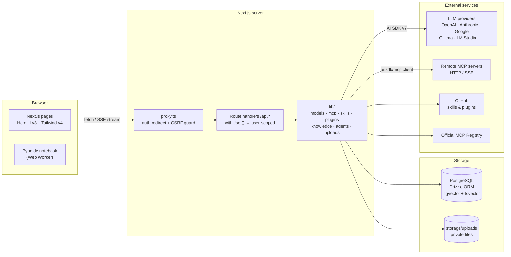

### One chat turn

The client sends only the new message; the server rebuilds the context, runs the model with every
tool the chat and its agent allow, pauses for approvals when a server's policy asks for one, and
saves the turn when the stream ends, even if the tab was closed.

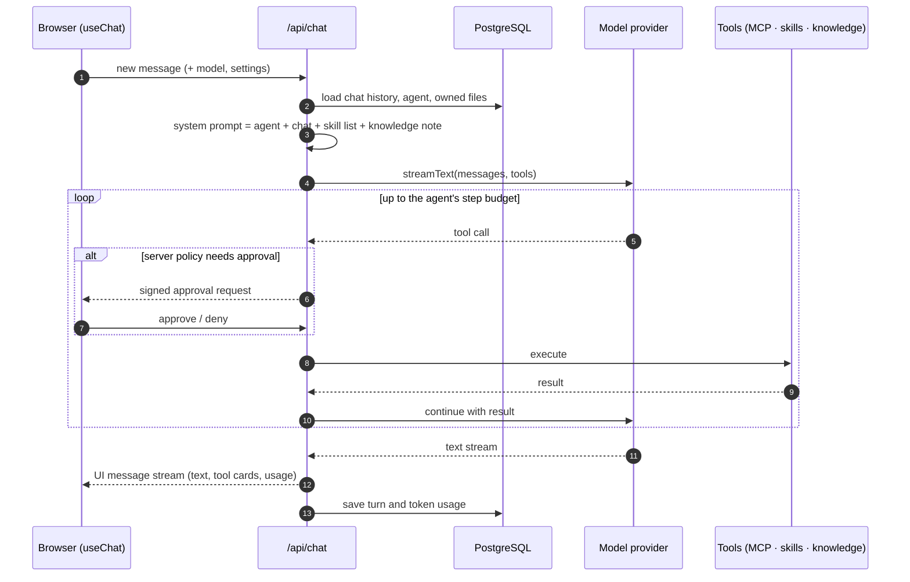

**What the model gets for a turn:**

| Source | Contributes |
| --- | --- |
| Agent | Instructions, default temperature, step budget, MCP servers, skills, knowledge bases |
| Chat | Its own system prompt and the MCP servers / knowledge bases switched on in the sidebar |
| MCP servers | Their tools, namespaced `<server>__<tool>`, each gated by the server's approval policy |
| Skills | Names and descriptions in the prompt; `load_skill` / `read_skill_file` fetch the rest when needed |
| Knowledge bases | A note listing them and the `search_knowledge` tool |

### Knowledge pipeline

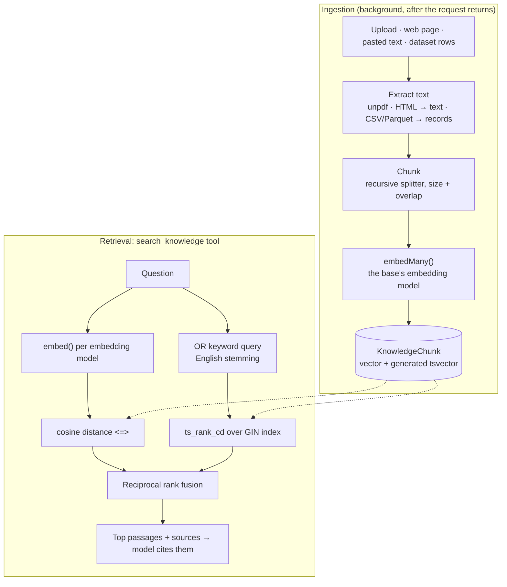

Each knowledge base fixes its embedding model, so bases built with different models can be searched
together: the question is embedded once per model, and the ranked lists are fused.

### Data model

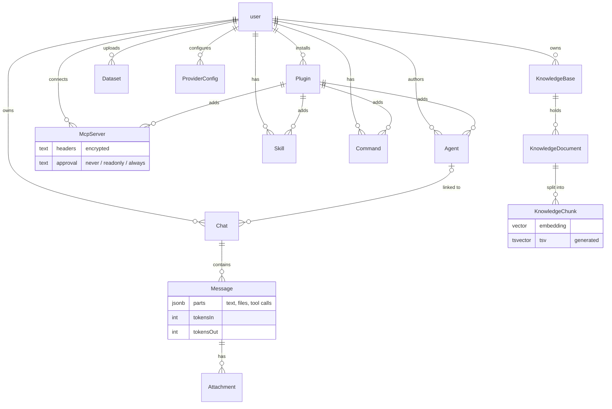

Deleting a plugin cascades to everything it installed; deleting a knowledge base removes its documents
and chunks. The schema lives in [`lib/schema.ts`](lib/schema.ts) and the migrations in [`drizzle/`](drizzle).

### Project layout

```text
app/
  (pages)            chat, agents, compare, skills, plugins, knowledge, datasets, embeddings,
                     models, providers, tools (MCP inspector), registry, analytics, config, …
  api/               route handlers, one folder per resource; every handler is wrapped in withUser()
  uploads/[name]     serves a private upload to its owner
components/
  ui/                design-system primitives: HeroUI components behind a stable props API
  chat/ compare/ analytics/ datasets/ skills/ …   feature components
hooks/               SWR data hooks (useAgents, useKnowledgeBases, usePlugins, …)
lib/
  models.ts          provider → AI SDK language/embedding model, per-user keys
  mcp.ts             MCP clients, tool namespacing, approval policy
  skills.ts          progressive-disclosure skill tools
  bundles.ts plugins.ts github-source.ts   SKILL.md / plugin parsing and GitHub fetching
  knowledge.ts rag-text.ts                 ingestion, chunking, hybrid search
  tabular.ts datasets.ts                   CSV/Parquet parsing and column profiling
  uploads.ts upload-access.ts              private file storage and access checks
  schema.ts db.ts    Drizzle schema and client
scripts/             mock-llm.ts, mock-mcp.ts, migrate-uploads.ts
drizzle/             SQL migrations
docker/              Dockerfile and compose files
```

### Design decisions

- **One AI layer.** Every provider goes through the AI SDK (`getModel` / `getEmbeddingModel`), so chat, tools, comparison and embeddings behave the same everywhere.
- **The server owns the conversation.** Clients send the new message only; history, tools and approvals are rebuilt on the server, so a modified client can't rewrite history or forge an approval.
- **Pure parsers, thin routes.** Skill/plugin parsing, chunking, CSV and MCP-config parsing, rank fusion and PATCH schemas are pure functions with unit tests; routes validate input with zod and stay small.
- **Postgres does the retrieval.** pgvector and full-text search run side by side in one database, so there's no separate vector store to run or keep in sync.
- **Design system behind stable props.** `components/ui` keeps one component API while rendering HeroUI v3, so the whole app moved to HeroUI at once and can keep evolving.

---

## Local stdio MCP servers

The hosted app can't start processes on your machine, so local servers (the `npx …` and `uvx …` kind) run
through a small bridge you start yourself. It launches the server once per session and exposes it as a
token-protected Streamable HTTP endpoint:

```bash
bun scripts/mcp-bridge.ts --port 8808 -- npx -y @modelcontextprotocol/server-filesystem ~/notes
```

It prints a URL and a bearer token. In the **MCP Inspector**, add `http://127.0.0.1:8808/mcp` with the header
`Authorization: Bearer <token>`. A self-hosted workbench reaches it directly (set `ALLOW_PRIVATE_PROVIDER_URLS=true`).
For the hosted app, expose it with a tunnel such as `cloudflared tunnel --url http://127.0.0.1:8808` and add the
tunnel's https URL instead.

## Security model

| Concern | How it's handled |
| --- | --- |
| Accounts | Better Auth (email/password, optional GitHub/Google); `withUser()` on every API route; queries scoped to `user.id` |
| Secrets | Provider keys and MCP headers encrypted with AES-256-GCM; never returned to the browser |
| Files | Stored outside `public/`, served only to their owner, never inlined into another user's chat |
| Outbound requests | SSRF guard on provider, MCP, plugin and knowledge URLs (private ranges blocked in production, no redirects) |
| Tool use | Per-server approval policy; approval requests are HMAC-signed and decisions are applied to the stored message |
| Cross-site requests | `proxy.ts` rejects cross-origin mutations; strict CSP and security headers |
| Sharing | Shared agents never expose the author's MCP servers, skills or knowledge bases |
| Code execution | The notebook runs Python in the browser (Pyodide); nothing executes on the server |

---

## Development

```bash
bun run dev          # Next.js dev server
bun run check        # typecheck + lint + unit tests (CI also runs a production build)
bun run db:generate  # create a migration after editing lib/schema.ts
bun run db:migrate   # apply migrations
```

**Mock services** for working without API keys:

| Command | Provides |
| --- | --- |
| `bun scripts/mock-llm.ts 4010` | OpenAI-compatible chat model `mock-echo`, embedding model `mock-embed`, and Studio endpoints (images, transcription, speech). Add it as an LM Studio provider at `http://127.0.0.1:4010/v1` or a custom provider at `http://127.0.0.1:4010`. Send `/call <tool> <json>` to make it call a tool. |
| `bun scripts/mock-mcp.ts 4020` | An MCP server at `http://127.0.0.1:4020/mcp` with read-only and destructive tools, a resource and a prompt |

CI ([`.github/workflows/ci.yml`](.github/workflows/ci.yml)) installs with a frozen lockfile, then runs typecheck, lint, tests and a production build.

---

## Roadmap

**Done in the v5 overhaul:** authentication and per-user data · AI SDK streaming · real remote MCP with approvals · agents ·
skills, commands and plugins · knowledge bases (RAG) · HeroUI v3 redesign with light/dark themes · model comparison ·
usage analytics · real dataset preview · private uploads · Studio (images, transcription, speech) ·
shareable read-only chats and branching · scheduled agents · HNSW indexes · MCP OAuth · stdio bridge for local MCP
servers · webhook notifications for scheduled runs · knowledge reranking.

**Next:**
- Email notifications for scheduled runs (webhooks work today)
- OAuth for the stdio bridge itself (it uses a bearer token today)

Ideas and bug reports are welcome in [Issues](https://github.com/scorpiontaj/mcp-workbench/issues).

---

## Contributing

1. Fork the repository and create a branch.
2. Run `bun run check` before pushing.
3. Open a pull request describing what changed and how you tested it.

## License

MIT, see [LICENSE](LICENSE).

<div align="center">

Made by [Tajeddine Bourhim](https://github.com/scorpiontaj) · [scorpiontaj.me](https://scorpiontaj.me)

</div>
