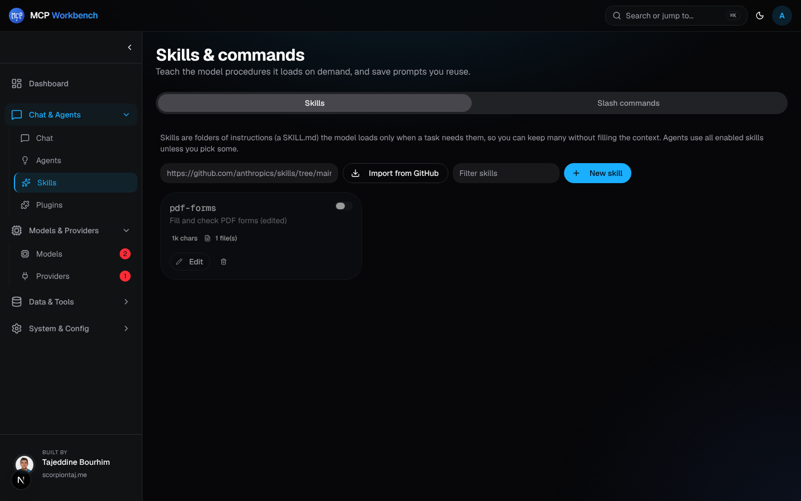

# MCP Workbench

<div align="center">

### A self-hostable AI workbench: chat with any model, give it tools (MCP), skills, plugins and your own documents

[](https://nextjs.org/)
[](https://react.dev/)
[](https://heroui.com/)
[](https://ai-sdk.dev/)
[](https://github.com/pgvector/pgvector)
[](https://orm.drizzle.team/)

[Features](#features) • [Screenshots](#screenshots) • [Quick start](#quick-start) • [Architecture](#architecture) • [Development](#development)

</div>

---

## Features

### Chat

- Streaming chat on the Vercel AI SDK with **13 providers**: OpenAI, Anthropic, Google, Groq, OpenRouter, Together, Mistral, Cohere, Hugging Face, Ollama, LM Studio, Replicate and any OpenAI-compatible endpoint
- Per-chat model, system prompt and sampling settings; stop, retry, regenerate and edit; image and file attachments
- **Slash commands**: type `/` to pick a saved prompt; `$ARGUMENTS` and `$1…$9` are filled from what you type
- Reactions, annotations, search across chats, JSON/CSV export
- An **inspector** panel showing every tool call, its input, output and timing

### Agents

- Reusable assistants with their own instructions, default model, temperature, step budget, starter prompts, **MCP servers, skills and knowledge bases**
- Six built-in agents; share yours with other users (they get the instructions, never your tools, keys or documents)

### MCP (Model Context Protocol)

- Connect **remote MCP servers** (Streamable HTTP / SSE) with encrypted auth headers
- Per-server **tool approval** policy (never / unless read-only / always), with HMAC-signed approvals so a client can't forge one
- **MCP Inspector**: list and run tools, read resources, get prompts
- **Registry**: browse the official MCP Registry and add servers in one click
- **Import** an `mcpServers` config from Claude Desktop, Cursor or VS Code

### Skills, commands and plugins

- **Agent Skills** (`SKILL.md` + resource files): the model sees only names and descriptions and loads a skill's instructions when a task needs it (progressive disclosure). Write them in the app or import from GitHub
- **Claude Code plugins** from GitHub or a marketplace (`.claude-plugin/marketplace.json`): review the contents first, then install skills, agents, slash commands and remote MCP servers together; update, disable or uninstall them as a unit

### Knowledge bases (RAG)

- Upload **PDF, HTML, Markdown, text, code, CSV or JSON**, add a web page, or paste text
- Chunking with overlap, embeddings with any embedding model from your providers, stored in **pgvector**
- **Hybrid retrieval**: vector similarity and Postgres full-text search, merged with reciprocal rank fusion
- Turn a knowledge base on in a chat or attach it to an agent: the model gets a `search_knowledge` tool and cites its sources
- A retrieval playground and a chunk viewer to tune chunk sizes

### Workbench tools

- **Models** browser with capability filters (vision, reasoning, embeddings, image generation)
- **Python notebook** running in the browser with Pyodide (nothing executes on the server)
- Datasets, embeddings playground, health dashboard (admins), feedback
- **HeroUI v3** interface with dark, light and system themes, a command palette (⌘K) and a responsive layout

### Security

- Accounts with Better Auth (email/password, optional GitHub/Google), every query scoped to the user
- Provider keys and MCP headers encrypted with AES-256-GCM, never returned to the browser
- SSRF guard on every outbound URL (providers, MCP servers, knowledge URLs), CSRF guard on mutating API routes

---

## Screenshots

<table>
<tr>
<td width="50%"><p align="center"><strong>Chat: the model searches a knowledge base</strong></p></td>
<td width="50%"><p align="center"><strong>Knowledge bases and hybrid retrieval</strong></p></td>
</tr>
<tr>
<td width="50%"><p align="center"><strong>Plugins from a Claude Code marketplace</strong></p></td>
<td width="50%"><p align="center"><strong>Skills and slash commands</strong></p></td>
</tr>
<tr>
<td width="50%"><p align="center"><strong>Agents (light theme)</strong></p></td>
<td width="50%"><p align="center"><strong>Settings and MCP config import</strong></p></td>
</tr>
</table>

---

## Quick start

Requirements: [Bun](https://bun.sh) and PostgreSQL with the [pgvector](https://github.com/pgvector/pgvector) extension (the dev compose file runs it for you).

```bash
git clone https://github.com/scorpiontaj/mcp-workbench.git
cd mcp-workbench
bun install

cp .env.example .env
# Set ENCRYPTION_KEY and BETTER_AUTH_SECRET (openssl rand -base64 32) and ADMIN_EMAILS (your email)

bun run docker:dev     # Postgres + pgvector on localhost:5432
bun run db:migrate     # creates the tables and enables the vector extension
bun run dev            # http://localhost:3000
```

Then sign up, add a provider on **Providers** (an API key, or the URL of a local Ollama / LM Studio) and start a chat.
For knowledge bases, pick an embedding model such as OpenAI `text-embedding-3-small` or Ollama `nomic-embed-text`.

Production: `bun run docker:prod` (multi-stage image running as non-root), then apply migrations as described in [docker/README.md](docker/README.md). Set `ALLOW_PRIVATE_PROVIDER_URLS=false` on a public deployment.

| Variable | Purpose |
| --- | --- |
| `DATABASE_URL` | PostgreSQL with pgvector |
| `ENCRYPTION_KEY` | Encrypts stored keys and headers (required) |
| `BETTER_AUTH_SECRET`, `BETTER_AUTH_URL` | Sessions and the app's public URL (required) |
| `ADMIN_EMAILS` | Emails that become admins on sign-up |
| `GITHUB_CLIENT_ID/SECRET`, `GOOGLE_CLIENT_ID/SECRET` | Optional OAuth sign-in |
| `GITHUB_TOKEN` | Optional; raises GitHub rate limits for skill and plugin imports |
| `OPENAI_API_KEY`, `ANTHROPIC_API_KEY`, `GOOGLE_API_KEY` | Optional server-wide fallback keys |

---

## Architecture

| Layer | Technology |
| --- | --- |
| UI | Next.js 16 App Router, React 19, **HeroUI v3** (React Aria + Tailwind CSS v4), Lucide, SWR, Zustand |
| AI | Vercel AI SDK v7 (`streamText`, tools with approvals, `embed`/`embedMany`), `@ai-sdk/mcp` |
| Data | PostgreSQL, Drizzle ORM, **pgvector** + `tsvector` full-text search |
| Auth | Better Auth |
| Parsing | `unpdf` for PDFs; small dependency-free parsers for `SKILL.md`, plugins, HTML and MCP configs |
| Notebook | Pyodide in a Web Worker |
| Tests | Vitest unit tests; Playwright for end-to-end checks against mock services |

Each chat turn assembles the model's context from the chat and its agent: instructions, MCP tools (with approval policies), the `load_skill` / `read_skill_file` tools for skills, and `search_knowledge` for attached knowledge bases.

---

## Development

```bash
bun run check        # typecheck + lint + unit tests
bun run db:generate  # new migration after editing lib/schema.ts
```

Mock services for testing without API keys:

- `bun scripts/mock-llm.ts 4010`: an OpenAI-compatible model (`mock-echo`) and embedding model (`mock-embed`). Add it as an LM Studio or custom provider at `http://127.0.0.1:4010/v1`. Send `/call <tool> <json>` to make it call a tool.
- `bun scripts/mock-mcp.ts 4020`: an MCP server with read-only and destructive tools, a resource and a prompt at `http://127.0.0.1:4020/mcp`.

Contributions are welcome: fork, create a branch, run `bun run check`, and open a pull request.

---

## License

MIT, see [LICENSE](LICENSE).

<div align="center">

Made by [Tajeddine Bourhim](https://github.com/scorpiontaj) · [scorpiontaj.me](https://scorpiontaj.me)

</div>
